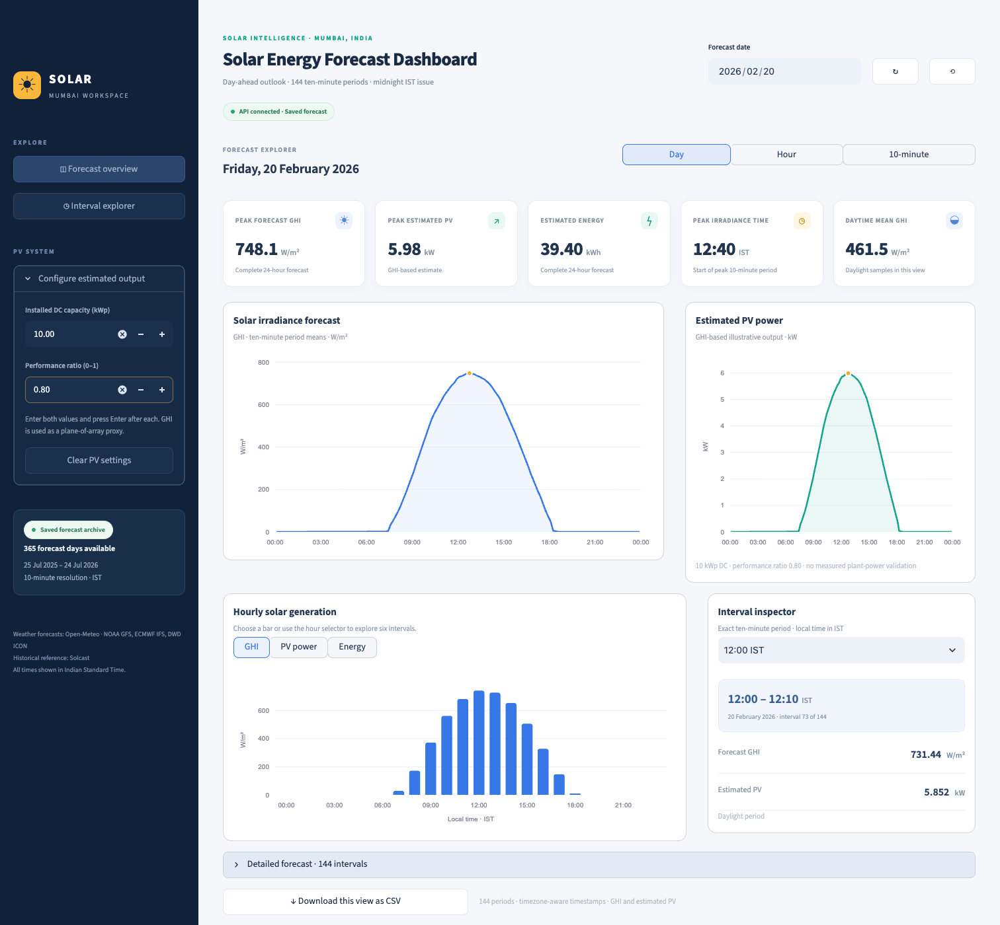
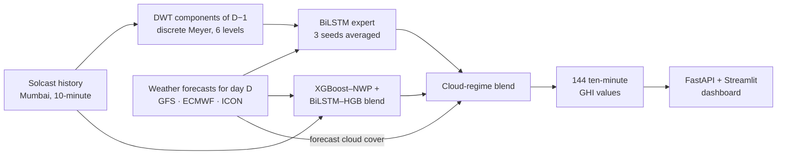
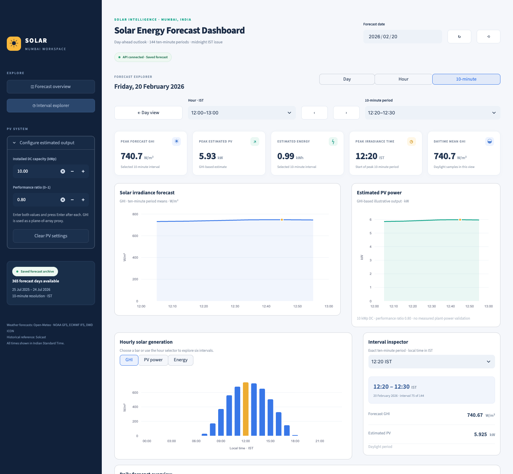
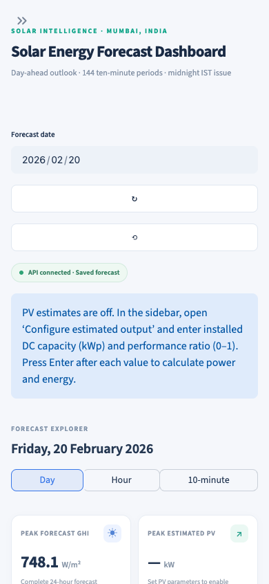

# A Multi-NWP-Guided Hybrid Deep Learning Framework for Day-Ahead Solar Irradiance Forecasting

Forecasting tomorrow's sunlight for Mumbai at 10-minute resolution, with an interactive dashboard for exploring the forecasts and estimating PV output.

Every midnight IST, the model forecasts the next 24 hours of global horizontal irradiance (GHI) as 144 ten-minute values. It combines three global weather models (GFS, ECMWF, ICON) with a wavelet-based BiLSTM, then blends the result with a gradient-boosted forecast according to how cloudy the day is expected to be.

**On a held-out test year, it cut hourly daylight RMSE by 23.6% compared with persistence and 18.0% compared with the best issue-time version of the published model it builds on.**



<sub>The PV values shown use 10 kWp and a 0.80 performance ratio, entered for illustration. PV fields start empty in the app.</sub>

## Results

Scores cover 365 test days (25 July 2025 to 24 July 2026) and 4,354 daylight hours.

| Forecast | RMSE (W/m²) | MAE (W/m²) | nRMSE (%) |
| --- | ---: | ---: | ---: |
| **Final model: cloud-regime blend** | **85.59** | **53.74** | **21.58** |
| NWP-guided DWT-BiLSTM alone | 84.31 | 54.22 | 21.26 |
| XGBoost–NWP blend alone | 92.83 | 58.05 | 23.41 |
| Bektaş & Altaş Model 2, forecast-day inputs copied from the previous day | 104.32 | 60.64 | 26.31 |
| Persistence (previous day repeated) | 111.95 | 63.03 | 28.23 |

Paired bootstrap 95% confidence intervals for the final model's change in RMSE:

| Compared with | RMSE change (W/m²) | 95% CI |
| --- | ---: | ---: |
| Persistence | −26.37 | −33.00 to −19.22 |
| Bektaş & Altaş Model 2 (table above) | −18.74 | −25.36 to −11.68 |
| XGBoost–NWP blend | −7.24 | −9.82 to −4.48 |
| NWP-guided DWT-BiLSTM alone | +1.28 | −0.77 to +3.12 |

The final model and the DWT-BiLSTM alone are statistically indistinguishable on this test year. The blend was chosen on development data, before the test year was scored.

Other useful views of the final model:

- **Ten-minute output:** RMSE 93.70 W/m², MAE 60.34 W/m² across 24,086 daylight samples.
- **Monsoon vs. the rest of the year:** hourly RMSE is 121.66 W/m² in the monsoon and 57.41 W/m² outside it. Monsoon cloud remains the hardest part of the problem.
- **Upper reference:** the published Model 2 reaches an RMSE of 64.56 W/m² when given the forecast day's *actual* observed weather. That information doesn't exist at forecast time, so it isn't a usable forecast and isn't ranked above.

## How it works



1. **Wavelet features.** The previous day's GHI is split into seven discrete Meyer components. They come from a trailing 168-day window, so no later observations leak into the input.
2. **Weather forecasts.** GFS, ECMWF IFS 0.25° and DWD ICON archived forecasts add hourly clear-sky index, cloud cover and daily clearness. If a model is missing on a given day, it's replaced by the mean of the models available that day.
3. **BiLSTM expert.** A 50-cell ReLU BiLSTM maps 24 hours × 24 features to hourly GHI. Three seeds are averaged, and output is forced to zero when the clear-sky estimate is below 10 W/m².
4. **Cloud-regime blend.** Forecast cloud cover selects how much weight the expert gets, with the rest going to the XGBoost–NWP blend:

   | Forecast daylight cloud cover | Expert weight |
   | --- | ---: |
   | Below 30% | 0.2 |
   | 30–70% | 0.4 |
   | 70% and above | 0.6 |

5. **Ten-minute output.** Hourly expert values are spread across six slots following the clear-sky shape, preserving the hourly mean and capping at 1.3 × clear sky, then blended.

### Evaluation

- **Training data:** 550 development days with archived forecasts (21 January 2024 to 23 July 2025), using expanding folds with a one-day purge.
- **Selection:** blend weights were chosen on 259 ranking days and had to beat the existing forecast on both RMSE and MAE on those days and on 110 later guard days. The weights were then frozen before the test year was scored.
- **Leakage checks:** tests confirm that operational inputs don't change when forecast-day observations are perturbed.

## Dashboard

The Streamlit and Plotly interface reads from a read-only FastAPI backend and serves the final model's 365 saved daily forecasts.

- Drill down from day to hour to individual 10-minute period, with every card and chart following the selection.
- Enter a DC capacity and performance ratio to get an estimate of PV power and energy.
- Download any view as CSV.
- Saved forecasts are checked against recorded SHA-256 fingerprints before being served, and there is no synthetic fallback data.

| Interval view | Mobile |
| --- | --- |
|  |  |

## Repository layout

```text
pv_pipeline/                 Data preparation, shared utilities, BiLSTM and HGB components
pipelines/
  paper_reproduction/        Bektaş & Altaş (2024) models on the Mumbai data
  xgboost_nwp/               XGBoost–NWP residual model and blend
  multi_nwp/                 ECMWF and ICON forecast download
  nwp_dwt_hybrid/            Final model: NWP-guided DWT-BiLSTM and cloud-regime blend
dashboard/                   FastAPI backend, Streamlit interface, tests
tests/                       Shared pipeline and project-layout tests
run.py                       Verifies the frozen XGBoost–NWP evaluation
```

## Running the code

This repository contains code only. **The datasets, trained models and saved forecasts are not included**, so the dashboard and full pipelines need those local files in `data/` and `results/`.

```bash
python -m venv .venv
.venv/bin/pip install -r requirements.txt -r dashboard/requirements.txt
```

These 24 pipeline tests run on a fresh clone. Run each suite in its own process, because Torch and XGBoost can conflict over OpenMP on macOS:

```bash
.venv/bin/python -m unittest discover -s pipelines/nwp_dwt_hybrid -p test_hybrid.py
.venv/bin/python -m unittest discover -s pipelines/paper_reproduction -p test_reproduction.py
.venv/bin/python -m unittest discover -s pipelines/xgboost_nwp -p test_pipeline.py
```

With the local data and results in place, you can also run:

```bash
# Dashboard: http://127.0.0.1:8501 (API docs: http://127.0.0.1:8000/docs)
.venv/bin/python dashboard/run.py

# Remaining tests
.venv/bin/python -m unittest discover -s tests
.venv/bin/pip install httpx
.venv/bin/python -m unittest discover -s dashboard/tests

# Final model
.venv/bin/python pipelines/nwp_dwt_hybrid/run.py --nwp-set multi --night-zero
```

## Limitations

- **Exploratory test scores:** the test year influenced earlier project iterations, so these results aren't a fully independent estimate of future performance.
- **Reference data:** the GHI used for scoring comes from Solcast's satellite and model-derived data, not a ground pyranometer.
- **One monsoon for blending:** blend weights were selected on 369 development days that include only one monsoon season.
- **No live forecasts:** the dashboard serves saved forecasts for the test year and can't generate forecasts for new dates.
- **Illustrative PV estimates:** PV output uses GHI as a plane-of-array proxy. It doesn't model tilt, temperature or inverter clipping, and hasn't been validated against measured plant output.

## Team

B.Tech Information Technology capstone project, MPSTME, SVKM's NMIMS (Deemed-to-be University), Mumbai, 2026.

- **Team:** Lakshmi Nair, Archita Narkar, Riya Sanghai, Purvi Tak
- **Project mentor:** Dr. Vikram Kulkarni

## References and data sources

- S. Ç. Bektaş and I. H. Altaş, "DWT-BILSTM-based models for day-ahead hourly global horizontal solar irradiance forecasting," *Neural Computing and Applications*, 36:13243–13253, 2024. [DOI: 10.1007/s00521-024-09701-2](https://doi.org/10.1007/s00521-024-09701-2)
- Historical irradiance and weather: [Solcast](https://solcast.com)
- Archived weather forecasts: NOAA GFS, ECMWF IFS and DWD ICON, through [Open-Meteo](https://open-meteo.com)
