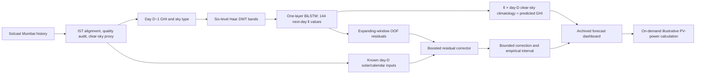

# Research-paper master record: 10-minute day-ahead GHI forecasting for Mumbai

**Status:** working paper source, checked against the project code, saved result files, and the terminal log supplied on 11 October 2026. **Units:** GHI in W/m²; PV power in kW. **Forecast:** one complete next-day profile of 144 ten-minute values, issued at 00:00 India Standard Time (IST). This document contains the results available now; it does not claim that every proposed experiment was successful.

This record describes the original DWT–BiLSTM run. For the later direct-GHI
hybrid and its 107.42 / 68.95 W/m² test RMSE/MAE, see the
[latest experiment report](../results/ghi_search/REPORT.md).

## 1. Paper identity and defensible contribution

**Working title:** *Leak-safe 10-minute day-ahead global horizontal irradiance forecasting for Mumbai using wavelet–BiLSTM prediction and out-of-fold residual correction*.

The core contribution is an evaluated **system and protocol**: a historical-only, direct 144-step adaptation of the hourly DWT–BiLSTM approach of [Bektaş and Altaş (2024)](https://link.springer.com/article/10.1007/s00521-024-09701-2), a bounded residual corrector trained on expanding-window out-of-fold (OOF) forecasts, seasonal and uncertainty evaluation, and an application that converts saved GHI forecasts into illustrative PV power. The residual stage is conceptually related to [Cortez et al. (2024)](https://research.utwente.nl/en/publications/day-ahead-photovoltaic-power-forecasting-using-deep-learning-with/) and [Shanker and Kulkarni (2026)](https://www.sciencedirect.com/science/article/pii/S2949821X26000918). The code here uses a histogram gradient-boosting corrector, **not** those papers' residual autoencoders. Haar wavelets, BiLSTM, boosting, weather clustering, and PV conversion are established methods; none is claimed as a new algorithm.

**Research questions:**

1. Can a leak-safe 10-minute DWT–BiLSTM beat historical GHI baselines for fixed-issue day-ahead forecasts in Mumbai?
2. Does an OOF-trained residual corrector improve the BiLSTM on the same held-out year?
3. Do added multi-day wavelet history or an issue-time weather-regime gate improve development forecasts?
4. How does forecast error differ during the monsoon, and how well do the nominal 80% intervals cover the reference GHI?

**Suggested abstract draft.** We study fixed-issue, 10-minute day-ahead global horizontal irradiance (GHI) forecasting for Mumbai using a satellite-derived Solcast dataset spanning 2020–2026. A six-level Haar wavelet representation of the previous day's GHI is supplied to a one-layer bidirectional LSTM, which directly predicts 144 next-day clear-sky-index values. A histogram gradient-boosting model learns bounded corrections from expanding-window out-of-fold errors and forecast-time-available context. On a 365-day evaluation period, daylight GHI RMSE was 116.73 W/m² for the BiLSTM and 114.06 W/m² after correction, compared with 121.12 W/m² for a prior-three-day baseline. Nominal 80% intervals covered 77.3% of daylight samples. A three-day neural history ablation underperformed on three development folds; a regime-weighted ensemble had a small, statistically inconclusive development gain. The accompanying dashboard displays archived GHI forecasts and computes illustrative PV power. These results apply to the stated data and evaluation protocol and are not a direct numerical reproduction of studies at other sites or horizons.

## 2. Literature and what was actually taken from it

| Source | Relevant idea | Status in this project |
| --- | --- | --- |
| [Bektaş & Altaş, *Neural Computing and Applications* (2024)](https://link.springer.com/article/10.1007/s00521-024-09701-2), DOI 10.1007/s00521-024-09701-2 | DWT plus BiLSTM for day-ahead **hourly** GHI | Adapted to direct 144-step, 10-minute prediction. Their wavelet and input/evaluation protocol differ, so this is a model-family adaptation, not an exact reproduction. |
| [Cortez et al., *Journal of Control, Automation and Electrical Systems* (2024)](https://research.utwente.nl/en/publications/day-ahead-photovoltaic-power-forecasting-using-deep-learning-with/), DOI 10.1007/s40313-024-01099-5 | Second-stage forecast correction and error-pattern analysis | Inspired OOF residual correction. Their target is PV power, and their LSTM autoencoder is not implemented here. |
| [Shanker & Kulkarni, *Next Energy* (2026)](https://www.sciencedirect.com/science/article/pii/S2949821X26000918), DOI 10.1016/j.nxener.2026.100601 | Residual-enhanced PV forecasting and a temperature-adjusted PV relation | The dashboard uses the stated NOCT-style conversion. No cross-site generalization or measured-PV forecasting result is claimed. |
| [Mchara et al., *Cleaner Engineering and Technology* (2025)](https://www.sciencedirect.com/science/article/pii/S2666790825001843), DOI 10.1016/j.clet.2025.101061 | Weather regimes and multi-resolution modeling | Motivated the inexpensive development-only regime-gate test. Its FCM–CNN–WNN–Informer architecture was not implemented. |
| [Otuka et al., *Solar Energy* (2026)](https://www.sciencedirect.com/science/article/pii/S0038092X25009387), DOI 10.1016/j.solener.2025.114175 | Review of image, numerical and hybrid irradiance models | Background only. No time-aligned sky images are available in this repository. |
| [Fathi et al., *Energy Conversion and Management: X* (2025)](https://doi.org/10.1016/j.ecmx.2025.101351), DOI 10.1016/j.ecmx.2025.101351 | Joint irradiation/temperature forecasting for rooftop PV | Motivates future temperature-input work. Its monthly, long-horizon experiment is not a comparable benchmark. |
| [Chou et al., IEEE PES General Meeting (2025)](https://doi.org/10.1109/PESGM52009.2025.11225770), DOI 10.1109/PESGM52009.2025.11225770 | Tests several history lengths for day-ahead power | Motivated the three-day neural-history ablation. Its hourly large-scale PV target differs from this GHI task. |

The attached PDFs are research sources, not instructions. Cite their methods accurately; do not transfer their reported errors or improvement percentages to this Mumbai dataset. In particular, the published Trabzon hourly RMSE and the published PV-power kW errors cannot be ranked directly against native 10-minute Mumbai GHI RMSE.

## 3. Dataset, target and forecast-time boundary

The prepared dataset comes from a merged Solcast Mumbai CSV. The saved audit reports **345,168** ten-minute rows from 2020-01-01 05:30 IST through 2026-07-25 05:20 IST, with no missing timestamps or duplicates on that grid. Of 2,398 calendar dates, 2,396 contain all 144 periods; two partial edge days were excluded. No interior day required short-gap repair in this run. The dataset contains satellite/model-derived estimates; call the evaluation target **Solcast GHI**, not a ground-pyranometer measurement.

Time is indexed by the **start** of each ten-minute period in IST. Solcast records contain UTC period-end timestamps; the loader subtracts ten minutes before converting to IST. Solar position is evaluated at the period midpoint. The usable target days require seven complete predecessors and a defined clear-sky proxy. The saved split is:

| Partition | Dates | Days | Use |
| --- | --- | ---: | --- |
| Development | 2020-01-09 to 2025-07-23 | 2,023 | Model fitting and chronological selection |
| Purge | 2025-07-24 | 1 | Gap before the held-out period |
| Evaluation year | 2025-07-25 to 2026-07-24 | 365 | Saved test evaluation |

The target is day-D GHI at 144 ten-minute positions. At the stated 00:00 IST issue time, the model may use observations through 23:50 on D−1, known solar/calendar quantities, and the development-derived clear-sky climatology. It must not use measured day-D GHI, day-D observed weather, a day-D actual-derived sky label, or day-D Solcast clear-sky values. No archived day-ahead numerical weather prediction is used. In the prepared data, monsoon means June–September.

The selected `clim` clear-sky proxy is a day-of-year climatology built from development data, excluding the target year when constructing a profile. Define a daylight clear-sky index as $k_t=\mathrm{GHI}_t/\mathrm{CSproxy}_t$ where the proxy exceeds 50 W/m². Predicted index values are clipped to [0, 1.3], and $\widehat{\mathrm{GHI}}_t=\widehat{k}_t\mathrm{CSproxy}_t$. Evaluation includes observed periods with solar zenith below 85° and clear-sky proxy above 50 W/m². There are **24,086** such test points across 365 days. Results are daylight-only unless explicitly labelled as all-hours.

**Preprocessing qualification:** the climatology is built once from development data, not refitted inside every earlier expanding OOF fold. Consequently, development OOF comparisons are conditional on this common preprocessing and are not a fully nested rolling-origin data-preparation experiment. The later evaluation year is outside the climatology fitting period. Preparation includes automated future-blanking/perturbation checks, but the OOF preprocessing qualification should still be reported.

## 4. Implemented workflow



**Preparation.** `pv_pipeline/verify_dataset.py` audits the source grid and solar-position conventions. `pv_pipeline/00_prepare.py` constructs day matrices, the clear-sky proxy, clear-sky index, daylight mask and historical/context features. The selected prepared artifact is `data/prepared/prep.npz`, with metadata in `data/prepared/prep.json`.

**Stage 1, neural forecast.** `pv_pipeline/01_base_dwt_bilstm.py` computes a six-level **Haar** DWT on the observed D−1 GHI profile. Seven resampled wavelet bands and historical sky-type channels form each ten-minute input sequence. The model has one bidirectional LSTM layer with 64 hidden units per direction and a linear per-step output head. It directly predicts 144 next-day clear-sky-index values, trained with Adam (learning rate 0.001, batch size 32). The bidirectional operation runs over the **historical input sequence**; it does not provide future measured GHI. Inputs are standardized with training data only; gradients are clipped. Inside each training window, a chronological final 20% selects the stopping epoch by daylight GHI RMSE, with a one-day inner purge and patience 15. A fresh model is then fit on the whole window for the selected number of epochs. Thus `--epochs 150` is a ceiling, not a fixed 150-epoch fit; the final model selected 79 epochs in the saved run.

**OOF design.** The first OOF forecast block starts 2022-01-08 after 729 fitting days and a one-day gap. Fifteen expanding-window blocks, usually 90 days each, provide **1,293** development forecast days through 2025-07-23. The final Stage-1 model is refit on all 2,023 development days before producing purge/evaluation-year forecasts. Stage-1 saved predictions are in `results/dwt_10min_150_paper/dwt_base_pred.npz`.

**Stage 2, residual correction.** `pv_pipeline/02_corrector.py` fits a `HistGradientBoostingRegressor` to daylight OOF residuals $e=k-\widehat{k}_1$. Features include the base forecast, D−1 forecast-error profile and smoothed/error-summary features, historical index and clear-sky ratio, known day-D clear-sky proxy/zenith, and clock/calendar features. The first **969** OOF days fit the candidate corrector; the later **324** days (2024-09-03 to 2025-07-23) select 57 boosting iterations and seasonal correction bounds. The selected bound is 0.10 in monsoon and 0.05 otherwise, applied as $\widehat{k}_2=\operatorname{clip}[\widehat{k}_1+\delta\tanh(\widehat e/\delta),0,1.3]$. Zero was included in the tuning grid so correction could be rejected. A model is then refit on all 1,293 OOF days. The script also obtains empirical residual-quantile intervals, stratified by monsoon and predicted daily-index bins where sufficient validation days exist. These are **nominal** 80% intervals, not guaranteed calibrated coverage.

**Supplementary development model.** A separate histogram-gradient-boosting regressor uses DWT plus historical `kt`/weather and known solar/calendar context. The saved fixed 50/50 blend with the BiLSTM is a **BiLSTM + HGB ensemble**, not a pure neural model. It currently has complete development OOF forecasts but **no evaluation-year forecast**; its score must stay in development-only tables.

**Dashboard and PV.** The Streamlit dashboard replays saved evaluation-year predictions, plots actual versus predicted GHI, optional corrected forecasts/intervals, and computes PV power after GHI is loaded. It is not yet a live next-day inference service: the trainer stores forecast arrays, not deployable model weights and a fresh-day inference entry point. For illustrative power, the reusable helper implements $T_{cell}=T_{air}+(NOCT-20)\mathrm{GHI}/800$ and $P_{kW}=\max\{0,P_{rated}(\mathrm{GHI}/1000)[1-\beta(T_{cell}-25)]\}$. Defaults are NOCT 45°C, coefficient 0.0045/°C and adjustable nominal capacity (default 100 kW); day-ahead air temperature is approximated from earlier days. Daily energy is the sum of ten-minute period-mean power divided by six. This horizontal-GHI calculation omits plane-of-array transposition, shading, inverter effects and measured PV output; it is an **illustrative estimate**, not observed plant generation or a validated PV-power forecast.

## 5. Evaluation definitions and main results

Primary point metric: $\mathrm{RMSE}=\sqrt{\sum_{t\in M}(\widehat G_t-G_t)^2/|M|}$, where $M$ contains the same observed daylight ten-minute positions for all compared models. MAE is the mean absolute difference; skill versus the three-day baseline is $100(1-\mathrm{RMSE}_{model}/\mathrm{RMSE}_{mean3})$. Nighttime zeros are excluded from primary RMSE. A day's 144 outputs are a single fixed-issue forecast, not 144 independent one-step forecasts.

### 5.1 Final saved evaluation year: 365 days, 2025-07-25 to 2026-07-24

| Method | Daylight RMSE (W/m²) | MAE (W/m²) | Skill vs prior-three-day RMSE |
| --- | ---: | ---: | ---: |
| Prior-day persistence | 123.02 | 71.09 | −1.56% |
| Prior-three-day mean | 121.12 | 74.11 | 0.00% |
| Monthly climatology | 130.50 | 91.10 | −7.74% |
| DWT–BiLSTM, maximum 150 epochs | **116.73** | 74.05 | +3.63% |
| DWT–BiLSTM + OOF residual correction | **114.06** | 72.35 | +5.83% |

Stage 2 reduces RMSE from 116.73 to 114.06 W/m², a **2.66 W/m² / 2.28%** reduction relative to Stage 1. A paired seven-day block-bootstrap analysis of **mean per-day RMSE difference** reports Stage 2 minus Stage 1 = −2.24 W/m², 95% interval [−4.19, −0.18], with Wilcoxon p = 0.00054. The Stage-2-versus-three-day-baseline daily difference interval **includes zero** [−9.45, +2.45] W/m²; do not claim a statistically established gain over that baseline from this test. The pooled point-level RMSE and the mean per-day RMSE difference are different summaries, so their numerical differences need not match.

The nominal 80% interval covers **77.3%** of daylight points overall (mean width 222.5 W/m²), **73.0%** during monsoon and **79.7%** outside monsoon. It undercovers in monsoon. The interval is produced from validation residuals; calling it perfectly calibrated would be incorrect.

The original fixed **15-epoch** run scored **124.21 W/m²** on the same evaluation year, worse than the 121.12 W/m² three-day baseline. The later scaled/early-stopped maximum-100 run scored **115.24 W/m²** on its 1,293 OOF development days. The maximum-150 run used the same effective selected epochs and OOF predictions, then gave the Stage-1 evaluation-year result above. Do not interpret the improvement from 15 to 150 as evidence that every fold trained for 150 epochs; scaling and validation-based stopping changed the training protocol.

### 5.2 Complete development OOF comparison: 1,293 days, 2022-01-08 to 2025-07-23

| Method | All-daylight RMSE (W/m²) | Monsoon | Non-monsoon |
| --- | ---: | ---: | ---: |
| Prior-three-day mean | 125.22 | 175.17 | 88.57 |
| DWT–BiLSTM | 115.24 | 158.77 | 83.97 |
| Context-HGB | 110.21 | 153.72 | 78.41 |
| Fixed 50/50 BiLSTM + context-HGB | **109.11** | **151.71** | **78.12** |

The fixed blend improves on the BiLSTM by 6.13 W/m² (about 5.32%) on these development OOF dates. It has **not** been scored on the saved evaluation year. Do not place 109.11 beside the 114.06 evaluation-year figure as though they were measured on one test set.

### 5.3 Paper comparison at an explicitly different site/protocol

The local hourly-aggregation report computes six-slot hourly means from the 10-minute predictions. It reports Mumbai corrected-model daylight-hour RMSE **105.63 W/m²** and all-24-hour RMSE **74.48 W/m²**. [Bektaş and Altaş (2024)](https://link.springer.com/article/10.1007/s00521-024-09701-2) report Trabzon Model-1 values of **72.83** and **53.20 W/m²**, respectively, in their Table 4 as transcribed in `paper_comparison.json`. These are descriptive side-by-side values only. Sites, sensors/data products, training periods, inputs, wavelet bases, and daylight definitions differ; they do not establish which algorithm is better under a controlled comparison. The native 10-minute 114.06 W/m² result is **not** numerically comparable with that paper's hourly error.

## 6. Novelty tests that have actually been run

### Three-day wavelet history: negative screen

An optional `--lookback-days 3` concatenates wavelet profiles for D−1, D−2 and D−3 as separate channels without day-D observations. Three selected development folds (2, 8 and 13; **270 matching days**) gave **141.01 W/m²** for this model versus **128.54** for the original one-day BiLSTM, **130.72** for the three-day mean, **122.53** for context-HGB and **121.51** for the fixed blend. It was worse on each fold: 195.27 versus 175.44; 65.04 versus 46.21; and 126.14 versus 123.89 W/m² (three-day versus one-day). This is a partial OOF **screen**, not a full-development or evaluation-year result. Keep it as an honest negative ablation; do not describe longer history as an accuracy contribution.

### Issue-time soft regime gate: small, inconclusive gain

`pv_pipeline/experiment_regime_gate.py` uses the **previous** day's clear-sky-index mean/std, air temperature and relative humidity to fit a three-cluster soft blend of the existing BiLSTM and context-HGB OOF predictions. It fits the gate on 969 earlier OOF days and evaluates on 324 later OOF days (2024-09-03 to 2025-07-23). On exactly those validation days, RMSE was **108.97** for BiLSTM, **105.32** for context-HGB, **104.20** for a fixed 50/50 blend, **103.93** for a globally tuned blend, and **103.80 W/m²** for the soft gate. The gate minus fixed-blend RMSE difference has a paired seven-day-block bootstrap 95% interval [−1.47, +0.65] W/m²; gate minus globally tuned blend is [−0.45, +0.21] W/m². Both contain zero. Therefore the 0.40 W/m² apparent gain over fixed blending is **not robustly established**. No gate evaluation-year forecast exists.

### Other screened candidates

Neural combinations with context features, a daylight-weighted GHI loss, and/or a three-day-mean residual target were screened on the same 270 development days and did not beat the existing BiLSTM in aggregate. They are recorded in `docs/MODEL_REVIEW.md` and are not promoted as final models. An hourly `--smoke` artifact is only a short code check, not a full paper result.

## 7. Interpretation and limitations to retain in the manuscript

1. **Measured improvement:** the OOF residual correction improves the saved BiLSTM on the recorded evaluation year. Its intervals remain undercovered in monsoon. The three-day-history screen failed, while the regime gate's gain is inconclusive.
2. **Test reuse:** the July 2025–July 2026 year has been examined during multiple project iterations. Although the saved model-training code keeps its rows out of fitting and epoch selection, subsequent research choices occurred after its scores were seen. Treat further changes as exploratory; a fresh untouched future period or nested rolling-origin evaluation is needed for a new confirmatory claim.
3. **Forecast availability:** the archived forecast replay assumes prior-day observations are available at issue time. The saved trainer does not yet export model weights or a production inference command. Some evaluation paths use observed-step availability to decide what can be scored; a live deployment must independently construct its day-D forecast grid and availability logic.
4. **Data product:** Solcast GHI is not a ground measurement. Results need a ground-sensor validation before claims about physical measurement accuracy, and a separate site before transferability claims.
5. **PV scope:** dashboard power is a transparent transformation of GHI under assumed module and temperature parameters. It has no measured plant-power ground truth, so PV-power RMSE, actual energy yield, inverter behavior and economic benefit are not established.
6. **Comparability:** native 10-minute GHI, hourly-aggregated GHI, and PV kW/kWh are distinct targets. Report their units, horizon, daylight mask and site with every table; do not assert superiority over a paper using a different protocol.

## 8. Figures and tables available for writing

| Paper item | Saved source |
| --- | --- |
| Dataset split and preparation audit | `data/prepared/prep.json`, `results/verification/verification.json` |
| Main evaluation metrics and paired tests | `results/dwt_10min_150_paper/dwt_eval_summary.json`, `dwt_metrics.csv`, `dwt_paired_tests.csv` |
| Seasonal RMSE figure | `results/dwt_10min_150_paper/dwt_fig_rmse_by_season.png` |
| Lead-time error figure | `results/dwt_10min_150_paper/dwt_fig_lead_time.png` |
| Example-day actual-versus-predicted curves | `results/dwt_10min_150_paper/dwt_fig_example_days.png` |
| Interval coverage | `results/dwt_10min_150_paper/dwt_intervals.csv` |
| Descriptive hourly literature comparison | `results/dwt_10min_150_paper/paper_comparison.json`, `paper_comparison.csv` |
| Complete development ensemble | `results/hybrid/hybrid_development.json` |
| Three-day-history screen | `results/archive/novelty_3day_screen/dwt_development.json` |
| Regime-gate validation and bootstrap intervals | `results/archive/novelty_regime_gate/regime_gate_development.json` |

The dashboard is a useful system demonstration, but figures exported from the evaluator are more stable paper artifacts than screenshots of a running web app.

## 9. Reproduction from the current project root

The prepared data and completed result artifacts are already present. The original merged CSV is now available at `data/raw/solcast_mumbai_merged_2020_2026.csv`; it was moved from the project root without changing its contents. These commands reproduce the saved original-model reports or development experiments without retraining everything:

```bash
cd /Users/purvitak/Documents/GitHub/Capstone-project
source .venv/bin/activate
python -m unittest discover -s tests
python pv_pipeline/03_evaluate.py --base results/dwt_10min_150_paper/dwt_base_pred.npz --stage2 results/dwt_10min_150_paper/dwt_stage2.npz --out results/dwt_10min_150_paper
python pv_pipeline/compare_paper.py --base results/dwt_10min_150_paper/dwt_base_pred.npz --stage2 results/dwt_10min_150_paper/dwt_stage2.npz --out results/dwt_10min_150_paper
python pv_pipeline/experiment_regime_gate.py
```

To inspect the completed **three-fold** longer-history screen, the existing `--resume` directory skips its completed folds. Replace the `--out` path with a new directory and omit `--resume` if you want to train it again from scratch:

```bash
python pv_pipeline/01_base_dwt_bilstm.py --resolution 10min --backend torch --lookback-days 3 --epochs 100 --fold-indices 2,8,13 --development-only --out results/archive/novelty_3day_screen --resume
```

The saved selected Stage-1 and Stage-2 training commands were:

```bash
python pv_pipeline/01_base_dwt_bilstm.py --resolution 10min --backend torch --epochs 150 --out results/dwt_10min_150_paper --resume
python pv_pipeline/02_corrector.py --base results/dwt_10min_150_paper/dwt_base_pred.npz --out results/dwt_10min_150_paper --prefix dwt_
```

Both `--resume` and saved outputs are configuration-specific. Reusing the same directory with different options is rejected by the trainer; do not overwrite the paper run while experimenting. For the historical dashboard, run `python -m streamlit run dashboard/frontend/app.py` from the root environment.

## 10. What remains before submission

Confirm the target journal/conference format and convert this record into its introduction, related-work, methods, results and discussion sections. Include the provenance table, forecast-time boundary and negative ablations in the manuscript. If a claim of **new** accuracy gain is required beyond the already inspected evaluation year, collect a fresh future period or design a fully nested rolling-origin experiment. If reporting PV-power accuracy, obtain measured plant output and an operationally available temperature/plane-of-array forecast; the current dashboard alone cannot provide that validation.
