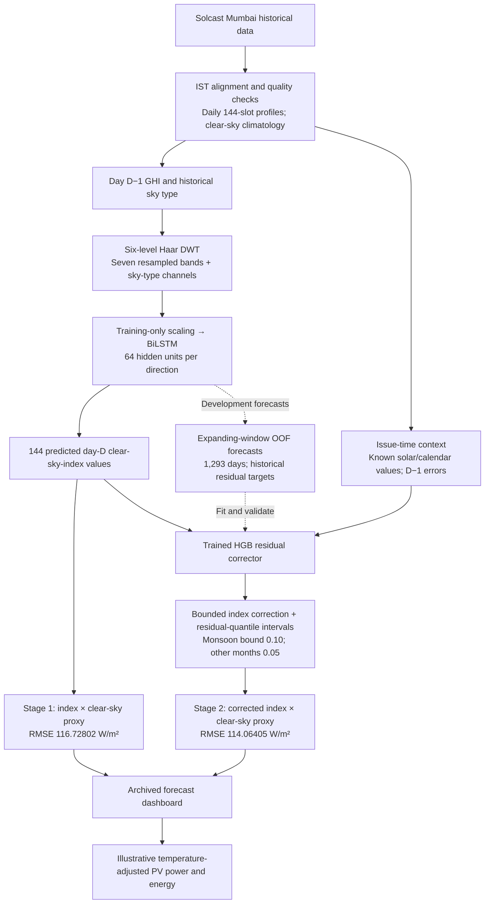

# Implementation results and base-paper comparison

Historical result snapshot. For the later hybrid, see the
[latest experiment report](../../results/ghi_search/REPORT.md).

Verified on 12 October 2026 by recomputing native metrics from saved prediction arrays and rerunning `pv_pipeline/compare_paper.py` into a temporary directory. Both matched the saved reports. This is a report of the completed run, not a new training experiment.

## Completed experiment

Selected run: `results/dwt_10min_150_paper`. Target: Solcast GHI for Mumbai, in W/m². A forecast issued at 00:00 IST predicts all 144 ten-minute periods of that day using prior-day history. Evaluation period: 25 July 2025–24 July 2026, 365 days and 24,086 daylight samples. Daylight requires solar zenith below 85° and clear-sky proxy above 50 W/m².

| Method | Daylight RMSE (W/m²) | Daylight MAE (W/m²) | RMSE reduction vs three-day mean |
| --- | ---: | ---: | ---: |
| Previous-day persistence | 123.01661 | 71.09302 | −1.56446% |
| Prior-three-day mean | 121.12171 | 74.10970 | 0% |
| Monthly climatology | 130.50009 | 91.10228 | −7.74294% |
| DWT–BiLSTM | 116.72802 | 74.05424 | 3.62750% |
| DWT–BiLSTM + OOF residual correction | **114.06405** | **72.34607** | **5.82692%** |

The full saved corrected RMSE is **114.06404890970941 W/m²**. Correction reduces the pooled RMSE by **2.663973768930404 W/m²**, or **2.282205855799091%**, relative to the BiLSTM. Corrected nRMSE is 26.60325% (normalized by mean daylight GHI), and mean bias is +2.38914 W/m². nRMSE is an error metric, not classification accuracy.

| Season | Days | Three-day mean RMSE | BiLSTM RMSE | Corrected RMSE |
| --- | ---: | ---: | ---: | ---: |
| Monsoon, June–September | 122 | 175.15588 | 164.18051 | 161.25754 |
| Non-monsoon | 243 | 76.84236 | 79.54089 | 76.78629 |

All seasonal errors are daylight GHI in W/m². Nominal 80% intervals cover 77.33123% overall, 73.04623% in monsoon, and 79.67746% outside monsoon. Overall mean interval width is 222.52764 W/m².

The saved paired seven-day block bootstrap gives a mean daily RMSE difference (corrected minus BiLSTM) of −2.23561 W/m², 95% interval [−4.19333, −0.18460], with Wilcoxon p = 0.0005351. This supports improvement over the BiLSTM. Against the three-day mean, the interval is [−9.44969, +2.45464] W/m² and includes zero. The pooled RMSE gain over that baseline is not statistically established by this paired analysis.

## Base paper

Bektaş and Altaş (2024), [*DWT-BILSTM-based models for day-ahead hourly global horizontal solar irradiance forecasting*](https://link.springer.com/article/10.1007/s00521-024-09701-2), Neural Computing and Applications, DOI 10.1007/s00521-024-09701-2.

The publisher article confirms the paper's identity, hourly task, discrete Meyer wavelet, input differences and all-hours results. Daylight values below are the project's existing Table 4 transcription in `paper_comparison.json`; the publisher's standalone Table 4 endpoint was unavailable during this verification.

Mumbai predictions and reference GHI are aggregated by averaging all six ten-minute samples within each hour. A local daylight hour contains at least one sample passing the daylight mask: 4,354 daylight hours, out of 8,760 total hours.

| Model | Site | Hourly daylight RMSE | Hourly daylight MAE | Hourly all-hours RMSE | Hourly all-hours MAE |
| --- | --- | ---: | ---: | ---: | ---: |
| Paper Model 1, DWT–BiLSTM | Trabzon | 72.83 | 53.20 | 53.20 | 27.67 |
| Paper Model 2, DWT–BiLSTM | Trabzon | 68.89 | 48.31 | 50.63 | 28.46 |
| Our DWT–BiLSTM, aggregated | Mumbai | 108.14479 | 66.92966 | 76.24744 | 33.38361 |
| Our corrected model, aggregated | Mumbai | **105.63435** | **65.32454** | **74.47768** | **32.58582** |

All errors are W/m². The paper reports lower numerical errors. This is a descriptive comparison across different sites, datasets, inputs and daylight definitions; it does not establish relative algorithm quality. Our native ten-minute RMSE must not be compared directly with the paper's hourly RMSE.

| Aspect | Base paper | Completed implementation |
| --- | --- | --- |
| Native output | Hourly day-ahead GHI | 144 ten-minute values at a fixed midnight issue |
| Wavelet | Discrete Meyer | Six-level Haar, seven resampled bands |
| Input availability | Includes forecast-day weather type; Model 2 also includes forecast-day meteorology | Prior-day GHI and sky type; correction uses known solar/calendar context and past errors |
| Model target | GHI | Clear-sky index, converted back to GHI |
| Additional stage | DWT–BiLSTM | OOF-trained histogram gradient-boosting residual corrector |
| Added evaluation | Paper's reported errors | Seasonal errors, paired tests and nominal 80% intervals |

The implemented contribution is the ten-minute historical-input adaptation and evaluated correction pipeline. There is no demonstrated accuracy improvement over the base paper on a common dataset. The separate 109.11 W/m² BiLSTM/context-HGB blend is a development-only result and has no saved test-year result. Dashboard PV is illustrative conversion; measured PV-power accuracy has not been established. The test year has been inspected across project iterations, and development OOF preprocessing uses a common development-derived climatology rather than a fully nested fold-specific preparation.

## Pipeline

Dashed arrows describe corrector training; solid arrows describe data and forecast flow. The clear-sky proxy is also used for interval conversion. The selected run allows up to 150 neural epochs with chronological validation and early stopping. The dashboard replays saved forecasts and does not provide live future-day inference.

Exportable diagram: [pipeline.svg](../figures/pipeline.svg).

Source artifacts: `results/dwt_10min_150_paper/dwt_eval_summary.json`, `dwt_metrics.csv`, `dwt_stage2.json`, `paper_comparison.json`, `dwt_base_pred.npz`, and `dwt_stage2.npz`. Machine precision values remain in the JSON reports; displayed tables are rounded to five decimal places.
